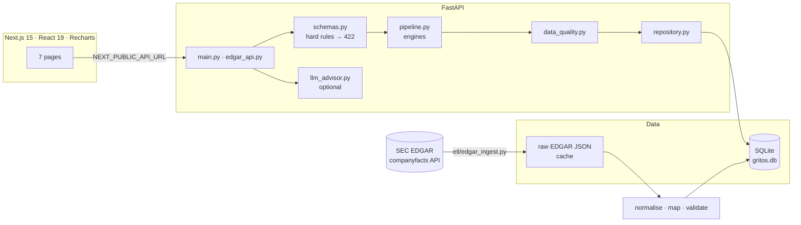

# GritOS

[](https://github.com/saivedulapurapu/GritOS/actions/workflows/tests.yml)

**Financial risk and scenario analytics for D2C businesses — manual scenarios and real SEC-filed financials.**

GritOS takes a business's monthly figures (revenue, ad spend, COGS, fixed costs, cash, inventory,
concentration), stress-tests them (revenue drop, ad-cost spike, COGS rise), and reports runway, a
fragility tier, a runway-decay estimate, a Grit Score and a data-quality report. It can run on
numbers you type in, or on quarterly financials of eight public D2C companies parsed from their
10-K / 10-Q filings, with every input labelled REAL / DERIVED / PROXY / ASSUMED.

## Features

| Area | What it does | Where |
|---|---|---|
| Unit economics | contribution margin, net profit, burn, runway (`None` = no cash burn) | `backend/financial_engine.py` |
| Stress test | revenue / CAC / COGS shocks; ad spend can stay fixed (default) or scale with volume | `backend/shock_engine.py` |
| Fragility tiers | Critical / Fragile / Stable / Resilient from documented rules (runway 3/6/12 months, margin 0/10/20 %, ad spend 50/30 %, HHI 2,500/1,500); baseline and stressed tier | `backend/fragility_model.py` |
| Runway-decay estimate | 6-month constant-hazard heuristic, λ = shocked runway × tier factor ≤ runway | `backend/runway_decay.py` |
| Shock sensitivity | months of runway lost per percentage point of total shock (12-month horizon) | `backend/fragility_model.py` |
| Concentration | Herfindahl-Hirschman Index of platform / supplier shares, US DOJ/FTC 2010 bands | `backend/dependency_index.py` |
| Grit Score | one function of a state: 0.5 tier + 0.5 decay estimate, × concentration × inventory, capped at 40 under 3 months of runway | `backend/grit.py` |
| Data quality | hard rules → HTTP 422 (`schemas.py`); scored report: completeness, validity, consistency, plausibility, and for SEC data provenance + source | `backend/data_quality.py` |
| Persistence | every analysis saved (SQLite): history and scenario detail | `backend/db.py`, [`backend/SCHEMA.md`](backend/SCHEMA.md) |
| SEC EDGAR | ingestion, normalisation, mapping to GritOS inputs, validation against operating cash flow | [`backend/etl/`](backend/etl/README.md) |
| AI advisor (optional) | Groq-hosted LLaMA chat and dashboard bullets; without `GROQ_API_KEY` the app works and says the advisor is off | `backend/llm_advisor.py` |

Frontend pages: Overview, Financial Profile, Stress Test, Risk Matrix, AI Strategy, Real Companies, History.

## Architecture



API routes: `GET /` · `POST /api/analyze` · `GET /api/mock` · `POST /api/chat` · `GET /api/history` ·
`GET /api/scenarios/{id}` · `GET /api/companies` · `GET /api/companies/{ticker}/quarters` ·
`POST /api/analyze/company/{ticker}?quarter=YYYY-Qn` · `GET /api/validation` (interactive docs at `/docs`).

## Data lineage (SEC EDGAR)

`raw companyfacts JSON` → facts per concept (tag fallback, USD only) → 10-K / 10-Q filter →
pre-listing shell filings dropped → restatements resolved (latest filed wins, original kept) →
quarters (reported, YTD differencing, Q4 = FY − Q1..Q3) → `financial_facts`, `restatements`,
`quarterly_financials` → mapped to GritOS inputs with provenance → analysed → validated against
reported operating cash flow. Details and every rule: [`backend/etl/README.md`](backend/etl/README.md).

## Dataset

Source: SEC EDGAR XBRL companyfacts (US government data, public domain).
Companies: Warby Parker, Allbirds, FIGS, The Honest Company, Hims & Hers, Lovesac, Purple, Peloton.
Full profile (generated): [`backend/data/EDGAR_PROFILE.md`](backend/data/EDGAR_PROFILE.md).

| Fact (run of 2026-11-06) | Value |
|---|---|
| Companies loaded / skipped | 8 / 0 |
| Company-quarters (all analysable) | 236 (2017-Q1 .. 2026-Q3) |
| Raw facts ingested → after unit + form filter | 8,176 → 8,146 |
| Duplicate facts collapsed | 3,703 |
| Restatements found | 212 (125 restatement, 81 rounding, 6 scale/entity) |
| Pre-listing (SPAC shell) facts dropped | 145 (Hims & Hers 50, Purple 95) |
| Q4 values derived / YTD → quarter conversions | 451 / 216 |
| Concepts with tag variants | 7 |
| Coverage, concept × quarter | REAL 56.9 %, DERIVED 26.6 %, PROXY 2.8 %, MISSING 13.7 % |
| GritOS input provenance | REAL 31.3 %, DERIVED 26.9 %, PROXY 3.3 %, ASSUMED 38.4 % |

**Validation** ([`backend/data/VALIDATION.md`](backend/data/VALIDATION.md)): over 231 company-quarters the
GritOS monthly net (= operating income / 3) differs from reported operating cash flow / 3 by a median
**12.5 % of revenue** (mean 15.1 %). Adding back stock-based compensation and D&A, which are expenses but
not cash, brings the median to **8.2 %**. GritOS is more pessimistic than cash flow in 73.2 % of quarters;
the sign (burning vs generating cash) agrees in 63.2 %.

## Model assumptions and limitations

- **Rule-based tiers.** Thresholds are stated judgement calls (common runway / margin rules of thumb and the
  DOJ/FTC HHI bands), not fitted to outcome data. Each result lists the rules that triggered it.
- **Runway-decay estimate is a heuristic**, not survival analysis: constant hazard with mean λ = runway ×
  tier factor (0.6 / 0.8 / 1.0 / 1.0). It is conservative — a 12-month runway scores 60.7 % at month 6 — and
  never exceeds the decay implied by face-value runway.
- **Grit Score weights** (50/50, ×0.9/×0.8 concentration, ×0.95/×0.85 inventory, cap 40) are documented in
  `grit.py` as choices, not estimates.
- **Ad spend in a downturn** defaults to staying fixed (the cautious case); "scales with volume" is an option.
- **SEC data:** shipping and returns cannot be separated (inside COGS / revenue); quarterly ad spend is a PROXY
  where no annual figure covers the quarter; concentration is not in the filings (manual, ASSUMED); inventory is
  counted in dollars at cost; these are larger public companies than the small businesses manual mode targets.
- **Provenance labels:** REAL (reported for the period, averaged to a month), DERIVED (computed from reported
  facts), PROXY (a reported figure standing in for another concept), ASSUMED (not in the data, stated default).

## Run it

Prerequisites: Python 3.13 (the version tested locally and in CI) and Node.js 18.18+ (required by Next.js 15; CI uses Node 22).

```bash
git clone https://github.com/saivedulapurapu/GritOS.git
cd GritOS
cp .env.example .env          # optional: GROQ_API_KEY; SEC_USER_AGENT (your own email) to load SEC data
```

- **Windows:** `.\run_gritos.ps1` (add `-LoadData` to download and load the SEC data)
- **macOS / Linux / Git Bash:** `./run.sh` (or `./run.sh --load-data`), or `make install` then `make backend` / `make frontend`

Both scripts create `backend/.venv`, install pinned dependencies, run `npm ci`, start the API on
http://localhost:8000 and the UI on http://localhost:3000. The SQLite database is created on first start.

### Load the SEC data

```bash
cd backend
SEC_USER_AGENT="GritOS research you@example.com" python -m etl.edgar_ingest --fetch --load
```

`--fetch` downloads the raw JSON once into `backend/data/raw/edgar/` (gitignored); `--load` re-normalises
from that cache without network access and prints the DATASET FACTS summary.

## Test

```bash
pip install -r backend/requirements-dev.txt
pytest                         # 401 tests, no network, no Groq key, in-memory SQLite per test
pytest --cov                   # backend coverage: 98 %
```

SEC tests use trimmed real snapshots in `backend/tests/fixtures/edgar/` (Peloton, Lovesac, Hims & Hers) and
hand-built facts for every normalisation rule. CI (`.github/workflows/tests.yml`) runs the backend tests
with an 85 % coverage floor and `npm ci && npm run build` for the frontend on every push.

## Changelog

- **v1 (May 2026):** prototype scenario calculator.
- **v2 (Nov 2026):** rebuilt with SEC EDGAR ingestion, data quality layer, persistence, honest models, tests and CI.
