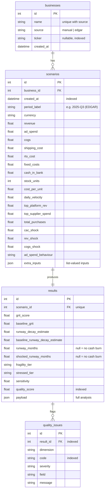

# GritOS database schema

SQLite via SQLAlchemy 2.0 (`backend/db.py`). The file is `backend/gritos.db` by default
(override with `GRITOS_DB_URL`) and is **not** committed. Tables are created on startup.
There are no migrations: after a schema change, delete `gritos.db` and it is recreated.

## Analysis tables

## Why each table exists

| Table | Why |
|---|---|
| `businesses` | The thing being analysed. Separating it lets history be grouped per business and lets the same name exist once per source (a manual "Acme" and an EDGAR company never collide). |
| `scenarios` | The exact inputs and shocks of one analysis, as typed columns rather than a JSON blob, so they can be queried ("every scenario with a revenue shock above 50 %") and audited. |
| `results` | The outputs. Headline numbers are columns so the History page can chart and sort them; the full analysis is kept as JSON so any past result can be re-displayed exactly as it was returned, even if the model changes later. One result per scenario (unique FK). |
| `quality_issues` | One row per data-quality issue rather than a list inside the result, so issues can be counted and filtered across runs ("how often is ad spend above revenue?"). |

## Indexes

- `scenarios(created_at)` and `scenarios(business_id, created_at)`: the History page lists newest first, optionally for one business.
- `results(scenario_id)` unique; `results(quality_score)`: sorting by quality.
- `quality_issues(result_id)`, `quality_issues(code)`: issue lookups and counts.
- `businesses(name, source)` unique; `businesses(ticker)`.

