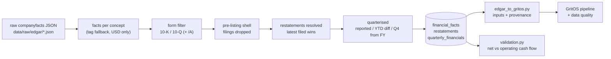

# SEC EDGAR pipeline

GritOS can analyse real companies using figures they filed with the US Securities and
Exchange Commission. This folder holds the pipeline that turns SEC filings into GritOS inputs.

## Source

- **SEC EDGAR XBRL "companyfacts" API** — `https://data.sec.gov/api/xbrl/companyfacts/CIK##########.json`,
  one JSON document per company with every XBRL fact from its filings.
- Ticker → CIK from `https://www.sec.gov/files/company_tickers.json`.
- Licence: US government work, public domain.
- Access rules followed: descriptive `User-Agent` with a contact email (`SEC_USER_AGENT`), under
  10 requests per second (`MIN_REQUEST_INTERVAL_S = 0.15`). Raw JSON is cached in
  `backend/data/raw/edgar/` (gitignored) so the SEC is only contacted on `--fetch`.

Companies: Warby Parker (WRBY), Allbirds (BIRD — files as "Smartbird, Inc."), FIGS, The Honest
Company (HNST), Hims & Hers (HIMS), Lovesac (LOVE), Purple Innovation (PRPL), Peloton (PTON).
All eight load; none was skipped. A company is skipped (and the reason recorded) only if it has
no raw file or no usable quarterly revenue.

## Running it

```bash
cd backend
SEC_USER_AGENT="GritOS research you@example.com" python -m etl.edgar_ingest --fetch --load
python -m etl.edgar_ingest --load        # re-normalise from the cache, no network
```

`--load` rebuilds the EDGAR tables in `backend/gritos.db`, recomputes validation, rewrites
`backend/data/EDGAR_PROFILE.md` and `backend/data/VALIDATION.md`, and prints the DATASET FACTS
block. Re-running is idempotent (a company's rows are replaced, not duplicated).

## Lineage



## Tag mapping

For each period the **first tag in the list that reports it** is used; the tag used is stored
with every value (`financial_facts.tag_used`, `quarterly_financials.detail`).

| Concept | XBRL tags (priority order) | Used for |
|---|---|---|
| revenue | `RevenueFromContractWithCustomerExcludingAssessedTax`, `Revenues`, `RevenueFromContractWithCustomerIncludingAssessedTax`, `SalesRevenueNet` | revenue |
| cogs | `CostOfGoodsAndServicesSold`, `CostOfRevenue`, `CostOfGoodsSold` | cogs, inventory velocity |
| operating_income | `OperatingIncomeLoss` | fixed costs (see below) |
| advertising | `AdvertisingExpense` (annual, 10-K note) | ad spend |
| marketing | `MarketingExpense`, `MarketingAndAdvertisingExpense`, `SellingAndMarketingExpense` | ad spend **PROXY** |
| general_admin, research_dev, sga | `GeneralAndAdministrativeExpense`, `ResearchAndDevelopmentExpense`, `SellingGeneralAndAdministrativeExpense` | profiled, not used in the mapping |
| cash | `CashAndCashEquivalentsAtCarryingValue`, `CashCashEquivalentsRestrictedCashAndRestrictedCashEquivalents` | cash in bank |
| inventory | `InventoryNet`, `RetailRelatedInventoryMerchandise`, `InventoryFinishedGoodsNetOfReserves`, `InventoryFinishedGoods` | inventory |
| operating_cash_flow | `NetCashProvidedByUsedInOperatingActivities` | validation |
| share_based_comp | `ShareBasedCompensation`, `AllocatedShareBasedCompensationExpense` | validation add-back |
| depreciation_amortization | `DepreciationDepletionAndAmortization`, `DepreciationAndAmortization` | validation add-back |

Tag variants actually found are listed per company in `data/EDGAR_PROFILE.md`
(e.g. Purple switched COGS from `CostOfGoodsAndServicesSold` to `CostOfRevenue` in 2022;
Lovesac switched inventory from `InventoryNet` to `RetailRelatedInventoryMerchandise` in 2021).

## Normalisation rules

Counts are from the run recorded in `data/EDGAR_PROFILE.md` (8 companies).

| # | Rule | Why | Count |
|---|---|---|---|
| 1 | Keep USD facts only | share counts etc. can share tag names | 0 (none of the mapped tags had other units) |
| 2 | Keep only 10-K, 10-Q and amendments | 8-K exhibits and proxy statements (DEF 14A) repeat figures, often rounded | 30 (all Hims 8-K facts) |
| 3 | Drop facts filed before the company's first revenue-bearing filing | companies that listed via SPAC / reverse merger (Hims & Hers, Purple) inherit the shell's earlier filings under the same CIK; e.g. Hims' 2020-Q1 cash was $1.48M in the shell's 10-Q vs $55.2M for the operating company | 145 |
| 4 | Same period, same value in several filings → one fact | every 10-K repeats prior years as comparatives | 3,703 collapsed |
| 5 | Same period, different values → **latest filed wins**; the superseded value is stored in `restatements` with a kind: `rounding` (≤ 0.1 %), `restatement`, `scale_or_entity` (≥ 10×) | restatements and reclassifications | 212 (125 restatement, 81 rounding, 6 scale/entity) |
| 6 | Quarters: reported ~90-day facts are REAL | | |
| 7 | YTD → quarter by differencing (Q2 = H1 − 3M, Q3 = 9M − H1, or 9M − Q1 − Q2) | cash-flow statements report year-to-date only | 216 |
| 8 | Q4 = FY − (Q1 + Q2 + Q3), else FY − 9M; flagged DERIVED | no filing reports Q4 on its own | 451 |
| 9 | Align by period end: quarter label = calendar quarter of (end − 15 days) | non-calendar fiscal years (Peloton June, Lovesac ~2 Feb on a 52/53-week calendar) | |
| 10 | Coverage matrix company × concept × quarter: REAL / DERIVED / PROXY / MISSING; gaps are never filled | | see profile |

## Mapping to GritOS inputs (`edgar_to_gritos.py`)

| GritOS input | Source | Provenance |
|---|---|---|
| revenue | quarterly revenue / 3 | REAL (DERIVED for derived quarters) |
| cogs | quarterly COGS / 3 | REAL (DERIVED for derived quarters) |
| ad_spend | FY `AdvertisingExpense` / 12, else marketing expense / 3 | DERIVED, else **PROXY** (overstates ads: includes staff and brand costs), else ASSUMED 0 |
| fixed_costs | (revenue − COGS − operating income) / 3 − ad spend | DERIVED; includes non-cash stock comp and D&A |
| shipping_cost, rto_cost | 0 | ASSUMED — included in COGS / netted from revenue |
| cash_in_bank | cash at quarter end | REAL |
| inventory | inventory at cost, counted as $1 units; velocity = COGS / days in quarter | REAL value, DERIVED velocity |
| concentration | not in companyfacts | ASSUMED — enter manually |
| currency | USD | |

**Why fixed costs come from operating income, not SG&A:** SG&A is not comparable across these
companies — Honest reports marketing as a separate line, Warby Parker includes it in SG&A. The
identity `operating expenses = revenue − COGS − operating income` holds for all of them, preserves
total operating expenses whatever the ad-spend source, and makes the GritOS monthly net equal to
reported operating income / 3, which the validation then checks against cash flow.

## Validation

`validation.py` compares the engine's monthly net with reported operating cash flow / 3 for
every quarter that has both. Result and method: `data/VALIDATION.md`; API: `GET /api/validation`.

## Known limitations

- **Shipping and returns cannot be separated**: they sit inside COGS / revenue in these filings.
- **Quarterly ad spend is a proxy** where no annual `AdvertisingExpense` covers the quarter
  (e.g. the current fiscal year before its 10-K); annual figures are spread evenly over 12 months.
- **Concentration is not in the data**: platform and supplier shares appear only in 10-K text.
- **Inventory units are dollars at cost**, so "days to sell through" is days of COGS, not product units.
- **These are larger public companies**, not the small D2C businesses GritOS's manual mode targets;
  stock-based compensation is a much bigger share of their costs.
- Rule 3 relies on the first revenue-bearing filing; a company whose first filings omitted
  revenue for another reason would lose those facts (none of the eight did).
- Quarter labels follow the period end date, so Lovesac's fiscal Q4 (Nov–Jan) is labelled Q1.
